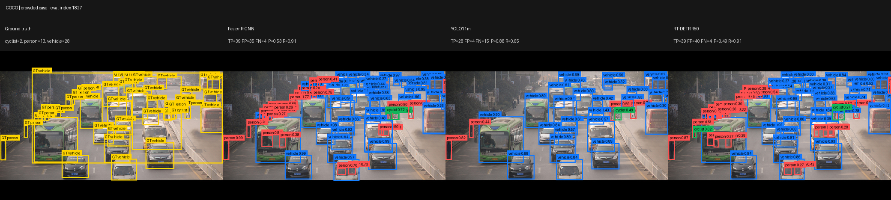
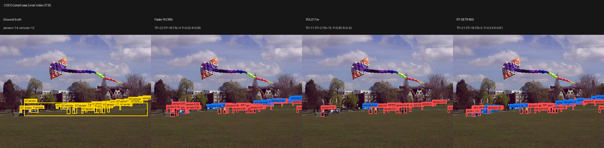
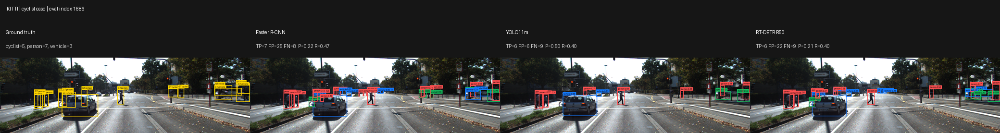
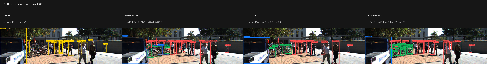

# Qualitative Failure Analysis

The qualitative analysis uses the same three pretrained detectors and the same unified `driving3` taxonomy as the full quantitative evaluation. Cases were selected automatically from ground-truth composition rather than hand-picked by model performance. For each selected image, detections from Faster R-CNN, YOLO11m, and RT-DETR R50 are compared against the same ground truth. Diagnostic TP/FP/FN counts use class-aware IoU >= 0.50 and are intended only for qualitative interpretation; the official quantitative results remain the full-dataset COCO-style metrics in `analysis/full_metrics.csv`.

## Recommended report cases

### 1. COCO crowded scene: density exposes a precision-recall tradeoff

Ground truth contains 43 objects (28 vehicles, 13 persons, and 2 cyclists). Faster R-CNN and RT-DETR each recover 39/43 objects at IoU 0.50, giving recall of 0.907, but they also produce many unmatched detections. Their diagnostic precisions are 0.527 and 0.494, respectively. YOLO11m is substantially more conservative: it produces only 32 predictions, reaches precision 0.875, but recall falls to 0.651.

This scene illustrates that similar aggregate AP can hide different operating behavior. Faster R-CNN and RT-DETR favor recall in a dense scene, while YOLO11m suppresses more uncertain boxes and sacrifices recall for precision. The visual panel also shows that most disagreements occur around partially occluded or tightly packed objects rather than the large, isolated vehicles.

| Model | TP | FP | FN | Precision | Recall | F1 |
|---|---:|---:|---:|---:|---:|---:|
| Faster R-CNN | 39 | 35 | 4 | 0.527 | 0.907 | 0.667 |
| YOLO11m | 28 | 4 | 15 | 0.875 | 0.651 | 0.747 |
| RT-DETR R50 | 39 | 40 | 4 | 0.494 | 0.907 | 0.639 |

### 2. COCO small-object scene: YOLO11m misses more distant objects

This image contains 26 annotated objects, of which 25 are categorized as small by the selection script. Faster R-CNN detects 22 and RT-DETR detects 21 at IoU 0.50, corresponding to recall of 0.846 and 0.808. YOLO11m produces only 13 predictions and matches 11 objects, reducing recall to 0.423 despite a high precision of 0.846.

This single-image behavior is consistent with the full COCO scale analysis, where YOLO11m has the lowest small-object AP of the three models. The scene makes the failure mode visible: the larger foreground objects are relatively easy, while many small and distant people/vehicles are omitted by the more conservative YOLO prediction set.

| Model | TP | FP | FN | Precision | Recall | F1 |
|---|---:|---:|---:|---:|---:|---:|
| Faster R-CNN | 22 | 18 | 4 | 0.550 | 0.846 | 0.667 |
| YOLO11m | 11 | 2 | 15 | 0.846 | 0.423 | 0.564 |
| RT-DETR R50 | 21 | 18 | 5 | 0.538 | 0.808 | 0.646 |

### 3. KITTI cyclist scene: cross-dataset taxonomy and box-definition mismatch

The KITTI scene contains 15 objects, including 5 `cyclist` instances. All three models struggle: Faster R-CNN matches 7/15 objects, while YOLO11m and RT-DETR each match 6/15. The panel shows a central reason why the aggregate KITTI cyclist AP is nearly zero. The COCO-pretrained detectors were learned from COCO's separate `person` and `bicycle` annotations, whereas KITTI's `Cyclist` label typically covers the rider and bicycle together. A detector may visually recognize the person and/or bicycle but still fail the class-aware IoU match against the combined KITTI cyclist box.

The failure therefore reflects more than visual domain shift. It also demonstrates a label-space and annotation-geometry mismatch introduced when a closed-set COCO detector is evaluated under a unified cross-dataset taxonomy. This is why cyclist AP should be interpreted separately from vehicle/person transfer performance.

| Model | TP | FP | FN | Precision | Recall | F1 |
|---|---:|---:|---:|---:|---:|---:|
| Faster R-CNN | 7 | 25 | 8 | 0.219 | 0.467 | 0.298 |
| YOLO11m | 6 | 6 | 9 | 0.500 | 0.400 | 0.444 |
| RT-DETR R50 | 6 | 22 | 9 | 0.214 | 0.400 | 0.279 |

### 4. KITTI person scene: clutter increases false positives for high-recall models

This scene contains 19 objects, including 18 persons, near a dense bicycle/person cluster. Faster R-CNN and RT-DETR both recover 13/19 objects (recall 0.684), but produce 19 and 29 false positives, respectively. YOLO11m matches one fewer object but produces only 7 false positives, yielding the best diagnostic F1 (0.632).

The visualization shows that the bicycle rack and tightly overlapping people create ambiguous local evidence. Faster R-CNN and especially RT-DETR emit more boxes around that region, while YOLO11m is more selective. This mirrors the crowded COCO example: YOLO tends toward fewer predictions and higher precision, whereas the other two detectors often preserve recall at the cost of duplicate or unmatched detections in clutter.

| Model | TP | FP | FN | Precision | Recall | F1 |
|---|---:|---:|---:|---:|---:|---:|
| Faster R-CNN | 13 | 19 | 6 | 0.406 | 0.684 | 0.510 |
| YOLO11m | 12 | 7 | 7 | 0.632 | 0.632 | 0.632 |
| RT-DETR R50 | 13 | 29 | 6 | 0.310 | 0.684 | 0.426 |

## Overall qualitative conclusions

The selected cases reinforce the quantitative results rather than replacing them. First, detector families exhibit different precision-recall behavior even when their overall mAP values are close: YOLO11m is often more conservative, while Faster R-CNN and RT-DETR recover more objects but can generate substantially more unmatched predictions. Second, small objects remain a difficult regime, with YOLO11m showing the clearest recall loss in the selected COCO small-object scene. Third, the near-zero KITTI cyclist AP across all three models is not adequately explained by architecture alone; the visual evidence supports a systematic COCO-to-KITTI class/box-definition mismatch. Finally, clutter and occlusion amplify false positives and class ambiguity, especially in crowded person/cyclist regions.

These examples should be used as qualitative evidence alongside the full-dataset metrics, not as standalone performance estimates. The case-level precision/recall/F1 values are diagnostic measurements at class-aware IoU 0.50, whereas the headline results use COCO-style AP@[0.50:0.95] over the full evaluation sets.
